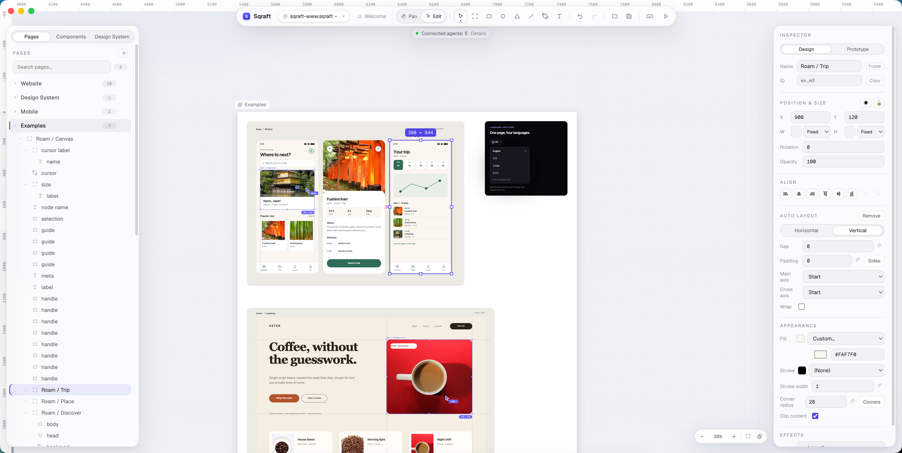

[English](README.md) · [中文](README.zh-CN.md) · **日本語** · [한국어](README.ko-KR.md)

# Sqraft

> AI 時代の軽量 UI デザインツール — デスクトップアプリ、ローカルファイル、オフラインでも使える。

フレーム、コンポーネント、オートレイアウト、デザイントークン、グラデーションで UI を設計できます。同じ機能は **MCP** 経由で Claude Code や Cursor などのエージェントにも公開され、「自然言語でデザインを編集する」ことが第一級の入口になります。

アプリは完全にローカルで動きます。アカウントもクラウドもモデル呼び出しもありません。デザインはディスク上の 1 つの `.sqraft` ファイルです。



## ダウンロード

### [⬇ 最新版をダウンロード](https://github.com/wfdx165/sqraft/releases/latest)

- **macOS 11.7 以降（0.1.2 以降）· Apple Silicon** · 約 120 MB · `Sqraft-<バージョン>-arm64.dmg`
- **macOS 11.7 以降（0.1.2 以降）· Intel** · 約 120 MB · `Sqraft-<バージョン>-x64.dmg`
- **Windows · x64** · 約 100 MB · 未署名
- Releases ページの **Assets** から、お使いの Mac に合う `.dmg`（`arm64` / `x64`）または `Sqraft-Setup-<バージョン>.exe` を選んでください。対応する `.zip` は macOS の自動更新がダウンロードするパッケージです
- Windows は Windows 10 22H2 以降または Windows 11（x64）が必要です。Linux は未対応
- 過去のバージョンと更新内容は [Releases](https://github.com/wfdx165/sqraft/releases) を参照

## インストール

### macOS

1. ダウンロードした `.dmg` を開き、**Sqraft** を「アプリケーション」にドラッグします
2. 署名と公証が済んでいるため、ダブルクリックでそのまま起動できます（手動での許可は不要です）
3. 以降は起動時に更新を確認します。新しいバージョンはバックグラウンドでダウンロードされ、ツールバーに「再起動して更新」が表示されます。終了するかそれをクリックすると更新が完了します

自動更新を使わない場合でも、メニューの **ヘルプ → アップデートを確認…** からいつでも手動で確認できます。

### Windows

1. `Sqraft-Setup-<バージョン>.exe` を実行します。インストーラーが未署名のため SmartScreen が警告します。**詳細情報 → 実行** を選んでください
2. ウィザードでインストール先を変更できます。既定では現在のユーザー向けにインストールされ、管理者権限は不要です。スタートメニューとデスクトップにショートカットが作成されます（デスクトップのものが不要なら削除してください）
3. `.sqraft` ファイルをダブルクリックすると Sqraft で開きます
4. 更新は手動です。新しいバージョンがあると **ダウンロード** のチップが表示され、Releases ページが開きます。アンインストールしてもデータは `%APPDATA%\Sqraft` に残ります

## できること

- **ベクターキャンバス**：矩形、楕円、多角形、直線、ペンツール、テキスト。無限キャンバス + 複数ページ
- **オートレイアウト**：方向、間隔、四辺の余白、hug / fill / fixed、折り返し、ドラッグで並べ替え
- **コンポーネント**：メインコンポーネント、インスタンス、スロット、インスタンスの上書きと差し替え。コンポーネントセットと列挙バリアント
- **プロトタイプリンク**：レイヤーをクリックして別ページへ遷移、または前のページへ戻る。即時 / フェードのトランジション、プレゼンモードでのページスクロール、`H` でホットスポット表示
- **デザイントークン**：色、数値（文字サイズ、角丸、間隔など）、グラデーション。1 か所変えれば全体に反映されます。厳格モードではエージェントが書いたリテラル色を `TOKEN_REQUIRED` として拒否し、最も近いトークンを提示します
- **編集操作**：複数選択、範囲選択、整列と分布、階層のドラッグ移動、グループ化、ガイド、スナップ
- **効果**：ドロップシャドウ、内側シャドウ、レイヤーブラー、背景ブラー
- **グラデーション**：線形、放射状、角度、ダイヤモンドの塗りと線。キャンバス上で端点 / 中心 / 半径 / 角度を直接ドラッグでき、色ストップはドラッグ・挿入・削除に対応。組み込みプリセット 6 種に加えて自作プリセット（ローカル保存）も使えます
- **画像**：ドラッグ、貼り付け、切り抜き、マスク、リンク画像（ローカルキャッシュ）。`.svg` をドロップすると編集可能なベクターとして読み込み、`⌥` を押しながらなら画像として挿入
- **AI 編集**：必要なページやサブツリーだけを検索・読み取り（10 万レイヤーの大きなファイルでも）、MCP 経由（35 ツール）でノード作成・スタイル変更を行います。書き込みのたびに警告（サイズ 0、テキストの見切れ、未定義トークン）が返るので、エージェント自身が修正できます。画像を読めないモデルは画面のテキスト要約を利用できます。プロトタイプリンクも張れるので、生成したデザインはそのままクリックで辿れます。1 回のツール呼び出し = 1 回の取り消し
- **サンプル**：ウェルカム画面にログイン、カード一覧、皆既日食ランディングの 3 つのサンプルがあり、開いて分解できます
- **書き出し**：書き出しマトリクスで PNG 1×/2×/4× と任意の SVG を 1 つの zip にまとめ（ドキュメント・ページ・レイヤー名で命名）、選択範囲やアクティブページから単体の PNG / SVG も書き出せます。右クリック `Copy as ▸` でクリップボードへ
- **表示言語**：中文 / English / 日本語 / 한국어（システム言語への自動追従も可）

## AI と接続

Sqraft 自体はモデルを呼ばず、API キーも不要です。アプリの実行中はローカルに MCP エンドポイントが立ち上がるので、お使いのエージェントを接続できます。

```
http://127.0.0.1:7331/mcp
```

アプリは起動したままにしてください（コマンドラインはなく、クライアントから起動することもできません）。ポートが使用中の場合は次の空きポートに移り、実際のアドレスはウェルカム画面と **Sqraft → MCP を設定…**（Windows ではファイルメニュー）に表示されます。

**Sqraft → MCP を設定…** を開き、使っているクライアントにチェックを入れてください。Sqraft は自分自身の `sqraft` エントリだけを書き込み、事前にバックアップし、ポート変更時はアドレスを同期します。書き込み後はクライアントを再起動してください。クライアントが見つからない、CLI がない、設定が書き込めない場合は下のスニペットを使ってください。Windows のワンクリック設定は実装済みですが実機検証は未実施です。スニペットは常に使えます。

<details>
<summary>Claude Code</summary>

```bash
claude mcp add --transport http sqraft http://127.0.0.1:7331/mcp
```

</details>

<details>
<summary>OpenCode</summary>

```jsonc
{
  "$schema": "https://opencode.ai/config.json",
  "mcp": {
    "servers": {
      "sqraft": { "type": "remote", "url": "http://127.0.0.1:7331/mcp" }
    }
  }
}
```

</details>

<details>
<summary>Cursor / その他の mcpServers クライアント</summary>

```jsonc
{
  "mcpServers": {
    "sqraft": { "url": "http://127.0.0.1:7331/mcp" }
  }
}
```

</details>


<details>
<summary>Codex</summary>

```toml
[mcp_servers.sqraft]
url = "http://127.0.0.1:7331/mcp"
```

</details>

<details>
<summary>VS Code</summary>

```jsonc
{
  "mcpServers": {
    "sqraft": { "type": "http", "url": "http://127.0.0.1:7331/mcp" }
  }
}
```

</details>

<details>
<summary>Zed</summary>

```jsonc
{
  "context_servers": {
    "sqraft": { "url": "http://127.0.0.1:7331/mcp" }
  }
}
```

</details>

エンドポイントは `127.0.0.1` のみを待ち受け、`Origin` ヘッダー付きのリクエストを拒否しますが、**トークンはありません**。同じマシン上の他のプロセスも接続できます。複数クライアントからのリクエストは順番に実行されます。

## ローカルファースト

- デザインはディスク上の `.sqraft` ファイル（zip コンテナ：スナップショット + 画像リソース）で、クラウドに依存しません
- アカウント、バックエンド、テレメトリはありません。外部への通信は更新確認と、自分で追加したリンク画像のみです
- 操作ログはシステムのログディレクトリ（macOS：`~/Library/Logs/Sqraft/`）に書き出されます。メニューの **ヘルプ → ログフォルダを開く** から直接開けます
- アンインストールするとアプリは削除されます。データディレクトリと設定は macOS では `~/Library/Application Support/Sqraft/`、Windows では `%APPDATA%\Sqraft` に残るので、必要なら一緒に削除してください

## ソースからビルド

macOS 11.7 以降（Sqraft 0.1.2 以降、Apple Silicon または Intel）または Windows（x64）、Node.js 22.12（`.nvmrc` を参照）、pnpm 10.33.4 が必要です。

```bash
pnpm install
pnpm dev      # 開発サーバー（レンダラーは HMR）
pnpm test     # 各パッケージの vitest
pnpm build    # 型チェック + 本番ビルド
pnpm dist     # ホスト OS 向けにビルド（macOS は arm64 と x64 の dmg と zip、Windows は x64 インストーラー）
```

`pnpm dist` は macOS 版の署名と公証を行うため、Developer ID 証明書と Apple の公証資格情報が必要です。署名なしのローカル確認には `pnpm dist:dir` を使ってください。

プロジェクト構成とレビュー手順は [CONTRIBUTING.md](CONTRIBUTING.md) を参照してください。

## 動作環境と既知の制限

- **macOS 11.7 以降**（Apple Silicon / Intel 両対応）
- **Windows 10 22H2 以降または Windows 11（x64）**。Windows ARM64（Windows on ARM）と Linux は未対応
- macOS 版は**署名・公証済み**のため、初回からダブルクリックで起動できます（「インストール」を参照）。Windows 版インストーラーは**未署名**のため、初回実行時に SmartScreen が警告します
- 自動更新は macOS のみ。Windows では新しいインストーラーを自分でダウンロードして実行します
- Figma ファイルの読み込みには対応していません。新規ドキュメントを作るか、SVG 素材を個別にドラッグしてください
- 中国語・日本語・韓国語は各 OS のフォントを使うため、同じドキュメントでも macOS と Windows で改行位置が変わることがあります
- リアルタイム共同編集、アカウント、クラウド同期はありません

## コミュニティ

- 質問やアイデア：[GitHub Discussions](https://github.com/wfdx165/sqraft/discussions)
- 不具合・機能要望：[Issues](https://github.com/wfdx165/sqraft/issues)

## ライセンスとフィードバック

Sqraft は [Apache License 2.0](LICENSE) で公開されています。「Sqraft」の名称とアプリアイコンはライセンスの対象外で、フォークは別の名前とアイコンを使用してください。

コントリビュートは歓迎です（[CONTRIBUTING.md](CONTRIBUTING.md)）。不具合や要望は [Issues](https://github.com/wfdx165/sqraft/issues) でお知らせください。

---

Sqraft = **Square**（四角）+ **Craft**（工芸）。
