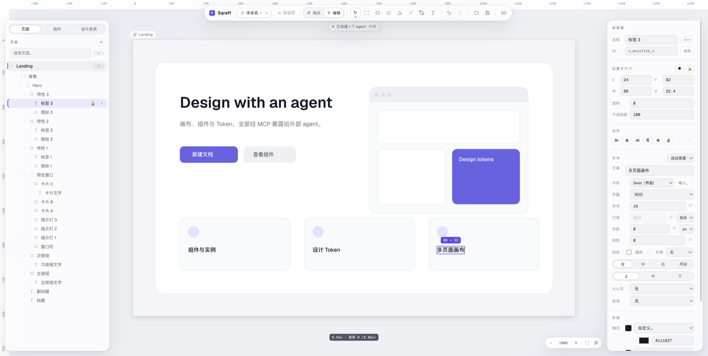

[English](README.md) · [中文](README.zh-CN.md) · **日本語** · [한국어](README.ko-KR.md)

# Sqraft

> AI 時代の軽量 UI デザインツール — デスクトップアプリ、ローカルファイル、オフラインでも使える。

フレーム、コンポーネント、オートレイアウト、デザイントークンで UI を設計できます。同じ機能は **MCP** 経由で Claude Code や Cursor などのエージェントにも公開され、「自然言語でデザインを編集する」ことが第一級の入口になります。

アプリは完全にローカルで動きます。アカウントもクラウドもモデル呼び出しもありません。デザインはディスク上の 1 つの `.sqraft` ファイルです。



## ダウンロード

### [⬇ 最新版をダウンロード](https://github.com/wfdx165/sqraft/releases/latest)

**macOS · Apple Silicon（M シリーズ）** · 約 120 MB · 未署名

- 配布は macOS arm64 のみです。Intel Mac、Windows、Linux は未対応
- 各バージョンで `.dmg`（手動インストール用）と `.zip`（自動更新用）の両方を提供します。Releases ページの **Assets** から `Sqraft-<バージョン>-arm64.dmg` を選んでください
- 過去のバージョンと更新内容は [Releases](https://github.com/wfdx165/sqraft/releases) を参照

## インストール

1. ダウンロードした `.dmg` を開き、**Sqraft** を「アプリケーション」にドラッグします
2. 初回起動は Gatekeeper に止められます（未署名のため）。表示されるメッセージは 2 種類です
   - 「開発元を検証できません」：アプリを**右クリック → 開く**、または「システム設定 → プライバシーとセキュリティ」で「このまま開く」を選びます
   - 「Sqraft は壊れているため開けません」：ファイルは壊れていません。下のコマンドを実行してください
3. 以降は起動時に更新を確認します。新しいバージョンはバックグラウンドでダウンロードされ、ツールバーに「再起動して更新」が表示されます。終了するかそれをクリックすると更新が完了します

「壊れている」と表示された場合は、アプリを「アプリケーション」に移動してからターミナルで実行してください。

```bash
xattr -dr com.apple.quarantine /Applications/Sqraft.app
```

もう一度開けば起動します。以降の更新はアプリ自身がダウンロードするため隔離属性は付かず、このメッセージは出ません。

自動更新を使わない場合でも、メニューの **ヘルプ → アップデートを確認…** からいつでも手動で確認できます。

## できること

- **ベクターキャンバス**：矩形、楕円、多角形、直線、ペンツール、テキスト。無限キャンバス + 複数ページ
- **オートレイアウト**：方向、間隔、四辺の余白、hug / fill / fixed、折り返し、ドラッグで並べ替え
- **コンポーネント**：メインコンポーネント、インスタンス、スロット、インスタンスの上書きと差し替え
- **デザイントークン**：色と数値（文字サイズ、角丸、間隔など）。1 か所変えれば全体に反映されます
- **編集操作**：複数選択、範囲選択、整列と分布、階層のドラッグ移動、グループ化、ガイド、スナップ
- **効果**：ドロップシャドウ、内側シャドウ、レイヤーブラー、背景ブラー
- **画像**：ドラッグ、貼り付け、切り抜き、マスク、リンク画像（ローカルキャッシュ）
- **AI 編集**：エージェントが MCP 経由でノード作成・スタイル変更・スクリーンショットでの自己確認を行います。1 回のツール呼び出し = 1 回の取り消し
- **書き出し**：PNG（倍率指定可）
- **表示言語**：中文 / English / 日本語 / 한국어（システム言語への自動追従も可）

## AI と接続

Sqraft 自体はモデルを呼ばず、API キーも不要です。アプリの実行中はローカルに MCP エンドポイントが立ち上がるので、お使いのエージェントを接続できます。

```
http://127.0.0.1:7331/mcp
```

アプリは起動したままにしてください（コマンドラインはなく、クライアントから起動することもできません）。ポートが使用中の場合は次の空きポートに移り、実際のアドレスはウェルカム画面と **Sqraft → MCP を設定…**（Windows / Linux ではファイルメニュー）に表示されます。

<details>
<summary>Claude Code</summary>

```bash
claude mcp add --transport http sqraft http://127.0.0.1:7331/mcp
```

</details>

<details>
<summary>OpenCode</summary>

```jsonc
{
  "$schema": "https://opencode.ai/config.json",
  "mcp": {
    "servers": {
      "sqraft": { "type": "remote", "url": "http://127.0.0.1:7331/mcp" }
    }
  }
}
```

</details>

<details>
<summary>Cursor / その他の mcpServers クライアント</summary>

```jsonc
{
  "mcpServers": {
    "sqraft": { "url": "http://127.0.0.1:7331/mcp" }
  }
}
```

</details>

エンドポイントは `127.0.0.1` のみを待ち受け、`Origin` ヘッダー付きのリクエストを拒否しますが、**トークンはありません**。同じマシン上の他のプロセスも接続できます。複数クライアントからのリクエストは順番に実行されます。

## ローカルファースト

- デザインはディスク上の `.sqraft` ファイル（zip コンテナ：スナップショット + 画像リソース）で、クラウドに依存しません
- アカウント、バックエンド、テレメトリはありません。外部への通信は更新確認と、自分で追加したリンク画像のみです
- 操作ログはシステムのログディレクトリ（macOS：`~/Library/Logs/Sqraft/`）に書き出されます。メニューの **ヘルプ → ログフォルダを開く** から直接開けます
- アンインストールするとアプリは削除されます。データディレクトリと設定は `~/Library/Application Support/Sqraft/` に残るので、必要なら一緒に削除してください

## 動作環境と既知の制限

- **macOS Apple Silicon**。Intel Mac は未対応
- アプリは**未署名・未公証**です。初回起動時は手動で許可が必要です（「インストール」を参照）
- 自動更新は macOS arm64 のみ。Windows / Linux のビルドはありません
- リアルタイム共同編集、アカウント、クラウド同期はありません

## ライセンスとフィードバック

Sqraft はクローズドソースのソフトウェアです。ソースコードは公開されておらず、インストーラは無料でダウンロードして使用できます。

不具合や要望は [Issues](https://github.com/wfdx165/sqraft/issues) で報告するか、インストーラを受け取った人に直接ご連絡ください。

---

Sqraft = **Square**（四角）+ **Craft**（工芸）。
