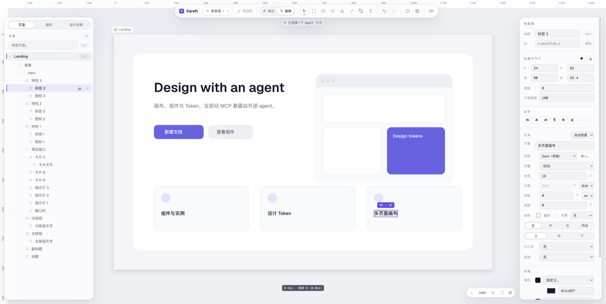

[English](README.md) · [中文](README.zh-CN.md) · [日本語](README.ja-JP.md) · **한국어**

# Sqraft

> AI 기반의 가벼운 UI 디자인 도구 — 데스크톱 앱, 로컬 파일, 오프라인에서도 동작합니다.

프레임, 컴포넌트, 오토 레이아웃, 디자인 토큰으로 인터페이스를 디자인합니다. 같은 기능을 **MCP**로 Claude Code, Cursor 같은 에이전트에 노출하므로 "자연어로 디자인 고치기"가 일급 진입점이 됩니다.

앱은 완전히 로컬에서 동작합니다. 계정도, 클라우드도, 모델 호출도 없습니다. 디자인은 디스크 위의 `.sqraft` 파일 하나입니다.



## 다운로드

### [⬇ 최신 버전 다운로드](https://github.com/wfdx165/sqraft/releases/latest)

- **macOS · Apple Silicon(M 시리즈)** · 약 120 MB · 미서명
- **Windows · x64** · 약 100 MB · 미서명
- Releases 페이지의 **Assets**에서 `Sqraft-<버전>-arm64.dmg`(수동 설치) 또는 `Sqraft-Setup-<버전>.exe`를 선택하세요. `.zip`은 macOS 자동 업데이트가 내려받는 패키지입니다
- Windows는 Windows 10 22H2 이상 또는 Windows 11(x64)이 필요합니다. Linux는 지원하지 않습니다
- 이전 버전과 업데이트 내용은 [Releases](https://github.com/wfdx165/sqraft/releases)에서 확인할 수 있습니다

## 설치

### macOS

1. 내려받은 `.dmg`를 열고 **Sqraft**를 「응용 프로그램」으로 끌어다 놓습니다
2. 첫 실행은 Gatekeeper가 막습니다(앱이 서명되지 않음). 안내는 두 가지 중 하나입니다
   - "개발자를 확인할 수 없습니다": 앱을 **오른쪽 클릭 → 열기**, 또는 「시스템 설정 → 개인정보 보호 및 보안」에서 「그래도 열기」를 선택합니다
   - "Sqraft가 손상되었습니다": 파일이 손상된 것이 아니므로 아래 명령을 실행합니다
3. 이후에는 실행할 때 업데이트를 확인합니다. 새 버전은 백그라운드에서 내려받고 툴바에 「재시동하여 업데이트」가 나타납니다. 종료하거나 그 버튼을 누르면 업그레이드가 끝납니다

"손상되었습니다" 안내가 나오면 앱을 「응용 프로그램」으로 옮긴 뒤 터미널에서 실행하세요.

```bash
xattr -dr com.apple.quarantine /Applications/Sqraft.app
```

다시 열면 실행됩니다. 이후 업데이트는 앱이 직접 내려받아 격리 플래그가 붙지 않으므로 이 안내는 다시 나오지 않습니다.

자동 업데이트를 원하지 않아도 메뉴 **도움말 → 업데이트 확인…**에서 언제든 직접 확인할 수 있습니다.

### Windows

1. `Sqraft-Setup-<버전>.exe`를 실행합니다. 설치 프로그램이 서명되지 않아 SmartScreen이 경고합니다. **추가 정보 → 실행**을 선택하세요
2. 마법사에서 설치 폴더를 바꿀 수 있습니다. 기본값은 현재 사용자 설치이며 관리자 권한이 필요 없습니다. 시작 메뉴와 바탕 화면에 바로 가기가 만들어지며, 바탕 화면 것이 필요 없으면 삭제하면 됩니다
3. `.sqraft` 파일을 두 번 클릭하면 Sqraft로 열립니다
4. 업데이트는 수동입니다. 새 버전이 있으면 **다운로드** 칩이 나타나 Releases 페이지를 엽니다. 앱을 제거해도 데이터는 `%APPDATA%\Sqraft`에 남습니다

## 할 수 있는 일

- **벡터 캔버스**: 사각형, 타원, 다각형, 직선, 펜 경로, 텍스트. 무한 캔버스 + 여러 페이지
- **오토 레이아웃**: 방향, 간격, 사방 여백, hug / fill / fixed, 줄바꿈, 드래그로 순서 변경
- **컴포넌트**: 메인 컴포넌트, 인스턴스, 슬롯, 인스턴스 오버라이드와 교체
- **프로토타입 링크**: 레이어를 클릭해 다른 페이지로 이동하거나 이전 페이지로 돌아갑니다. 즉시 / 페이드 전환, 프레젠테이션 모드의 페이지 스크롤, `H`로 핫스팟 표시
- **디자인 토큰**: 색상과 수치(글자 크기, 모서리 반경, 간격 등). 한 곳만 바꾸면 전체에 적용됩니다
- **편집**: 다중 선택, 영역 선택, 정렬과 분포, 계층 드래그, 그룹, 가이드, 스냅
- **효과**: 드롭 섀도, 내부 섀도, 레이어 블러, 배경 블러
- **이미지**: 끌어 넣기, 붙여넣기, 자르기, 마스크, 링크 이미지(로컬 캐시)
- **AI 편집**: 에이전트가 MCP로 노드를 만들고 스타일을 바꾸며 스크린샷으로 스스로 확인합니다. 프로토타입 링크도 연결하므로 생성한 디자인을 바로 클릭해 살펴볼 수 있습니다. 도구 호출 1회 = 실행 취소 1회
- **내보내기**: PNG(배율 지원)
- **인터페이스 언어**: 中文 / English / 日本語 / 한국어(시스템 언어 자동 따르기 지원)

## AI 연결

Sqraft는 모델을 호출하지 않고 API 키도 필요 없습니다. 앱이 실행되는 동안 로컬에 MCP 엔드포인트를 열어 두므로, 사용 중인 에이전트를 연결할 수 있습니다.

```
http://127.0.0.1:7331/mcp
```

앱은 계속 실행 중이어야 합니다(명령줄 도구가 없고, 클라이언트가 앱을 실행하지도 않습니다). 포트가 사용 중이면 다음 빈 포트로 옮겨가며, 실제 주소는 환영 화면과 **Sqraft → MCP 설정…**(Windows는 파일 메뉴)에 표시됩니다.

<details>
<summary>Claude Code</summary>

```bash
claude mcp add --transport http sqraft http://127.0.0.1:7331/mcp
```

</details>

<details>
<summary>OpenCode</summary>

```jsonc
{
  "$schema": "https://opencode.ai/config.json",
  "mcp": {
    "servers": {
      "sqraft": { "type": "remote", "url": "http://127.0.0.1:7331/mcp" }
    }
  }
}
```

</details>

<details>
<summary>Cursor / 기타 mcpServers 클라이언트</summary>

```jsonc
{
  "mcpServers": {
    "sqraft": { "url": "http://127.0.0.1:7331/mcp" }
  }
}
```

</details>

엔드포인트는 `127.0.0.1`만 수신하고 `Origin` 헤더가 있는 요청은 거부하지만, **토큰은 없습니다**. 같은 컴퓨터의 다른 프로세스도 연결할 수 있습니다. 여러 클라이언트의 요청은 차례로 실행됩니다.

## 로컬 우선

- 디자인은 디스크 위의 `.sqraft` 파일(zip 컨테이너: 스냅샷 + 이미지 리소스)이며 클라우드에 의존하지 않습니다
- 계정, 백엔드, 텔레메트리가 없습니다. 외부 요청은 업데이트 확인과 직접 추가한 링크 이미지뿐입니다
- 조작 로그는 시스템 로그 디렉터리(macOS: `~/Library/Logs/Sqraft/`)에 기록되며, 메뉴 **도움말 → 로그 폴더 열기**로 바로 열 수 있습니다
- 앱을 삭제하면 앱은 사라지고, 데이터 디렉터리와 환경 설정은 macOS에서는 `~/Library/Application Support/Sqraft/`, Windows에서는 `%APPDATA%\Sqraft`에 남으므로 함께 지울 수 있습니다

## 소스에서 빌드

macOS(Apple Silicon) 또는 Windows(x64), Node.js 22.12(`.nvmrc` 참고), pnpm 10.33.4가 필요합니다.

```bash
pnpm install
pnpm dev      # 개발 서버, 렌더러 HMR
pnpm test     # 각 패키지의 vitest
pnpm build    # 타입 검사 + 프로덕션 빌드
pnpm dist     # 호스트 플랫폼용 빌드(macOS는 미서명 arm64 dmg와 zip, Windows는 x64 설치 프로그램)
```

프로젝트 구조와 리뷰 절차는 [CONTRIBUTING.md](CONTRIBUTING.md)를 참고하세요.

## 시스템 요구 사항과 알려진 제한

- **macOS Apple Silicon(M 시리즈)**. Intel Mac은 지원하지 않습니다
- **Windows 10 22H2 이상 또는 Windows 11(x64)**. Windows ARM64(Windows on ARM)와 Linux는 지원하지 않습니다
- 두 플랫폼 모두 설치 프로그램이 **미서명·미공증**이므로 첫 실행 시 직접 허용해야 합니다(「설치」 참고)
- 자동 업데이트는 macOS에서만 제공합니다. Windows에서는 새 설치 프로그램을 직접 내려받아 실행합니다
- 중국어·일본어·한국어는 각 OS의 글꼴을 사용하므로 같은 문서라도 macOS와 Windows에서 줄바꿈 위치가 달라질 수 있습니다
- 실시간 협업, 계정 시스템, 클라우드 동기화는 없습니다

## 라이선스와 피드백

Sqraft는 [Apache License 2.0](LICENSE)으로 공개되어 있습니다. "Sqraft" 이름과 앱 아이콘은 라이선스 대상이 아니며, 포크는 다른 이름과 아이콘을 사용해야 합니다.

기여를 환영합니다([CONTRIBUTING.md](CONTRIBUTING.md)). 버그나 기능 제안은 [Issues](https://github.com/wfdx165/sqraft/issues)에 남겨 주세요.

---

Sqraft = **Square**(사각형) + **Craft**(공예).
