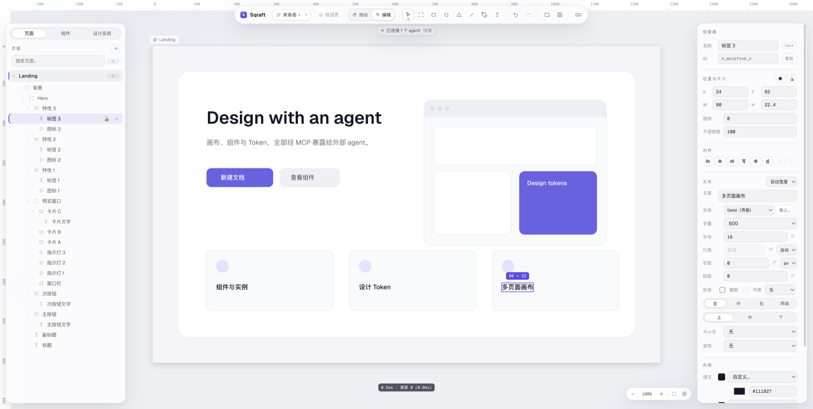

**English** · [中文](README.zh-CN.md) · [日本語](README.ja-JP.md) · [한국어](README.ko-KR.md)

# Sqraft

> AI-friendly, lightweight UI design tool — a desktop app with local files that works offline.

Design interfaces with frames, components, auto layout and design tokens; the same capabilities are exposed over **MCP** to agents such as Claude Code and Cursor, so "edit the design in natural language" is a first-class entry point.

The app is fully local: no account, no cloud, no model calls. A design is simply a `.sqraft` file on disk.



## Download

### [⬇ Download the latest version](https://github.com/wfdx165/sqraft/releases/latest)

- **macOS · Apple Silicon (M series)** · about 120 MB
- **Windows · x64** · about 100 MB · unsigned
- Under **Assets** on the Releases page pick `Sqraft-<version>-arm64.dmg` (manual install) or `Sqraft-Setup-<version>.exe`; the `.zip` is what the macOS updater downloads
- Windows 10 22H2 or Windows 11, x64. Linux is not supported
- Older versions and release notes: [Releases](https://github.com/wfdx165/sqraft/releases)

## Install

### macOS

1. Open the downloaded `.dmg` and drag **Sqraft** into Applications
2. Double-click **Sqraft** in Applications — it opens directly, with no security prompt
3. Afterwards the app checks for updates on launch: new versions download in the background, a "Restart to update" button appears in the toolbar, and quitting or clicking it finishes the upgrade

If you would rather not auto-update, **Help → Check for Updates…** checks manually at any time.

### Windows

1. Run `Sqraft-Setup-<version>.exe`. SmartScreen warns because the installer is unsigned: click **More info → Run anyway**
2. The wizard lets you choose the install folder; by default it installs for the current user (no administrator rights). Start-menu and desktop shortcuts are created — just delete the desktop one if you don't want it
3. Double-click any `.sqraft` file to open it in Sqraft
4. Updates are manual: when a new version is out, the app shows a **Download** chip that opens the Releases page; uninstalling keeps your data in `%APPDATA%\Sqraft`

## What you can do

- **Vector canvas**: rectangles, ellipses, polygons, lines, pen paths, text; infinite canvas with multiple pages
- **Auto layout**: direction, gap, padding, hug / fill / fixed, wrapping, drag to reorder
- **Components**: main components, instances, slots, instance overrides and swapping
- **Prototype links**: click a layer to jump to another page or go back, with instant / fade transitions; present mode scrolls pages and `H` highlights hotspots
- **Design tokens**: colors and numbers (font size, radius, spacing…); change once and it applies everywhere
- **Editing**: multi-select, marquee, align and distribute, drag to reparent, grouping, guides, snapping
- **Effects**: drop shadow, inner shadow, layer blur, background blur
- **Images**: drag in, paste, crop, mask, linked images (cached locally)
- **AI editing**: agents create nodes, change styles and screenshot the result over MCP; they can also wire prototype links, so a generated design is clickable; one tool call = one undo step
- **Export**: PNG (with scale)
- **Interface languages**: 中文 / English / 日本語 / 한국어, with optional automatic system-language detection

## Connect AI

Sqraft never calls a model and needs no API key. While the app is running it serves an MCP endpoint on localhost, so you can attach the agent you already use:

```
http://127.0.0.1:7331/mcp
```

The app must stay running (there is no CLI, and clients cannot launch it). If the port is taken the app moves to the next free one; the actual address is shown on the welcome page and under **Sqraft → Configure MCP…** (in the File menu on Windows).

<details>
<summary>Claude Code</summary>

```bash
claude mcp add --transport http sqraft http://127.0.0.1:7331/mcp
```

</details>

<details>
<summary>OpenCode</summary>

```jsonc
{
  "$schema": "https://opencode.ai/config.json",
  "mcp": {
    "servers": {
      "sqraft": { "type": "remote", "url": "http://127.0.0.1:7331/mcp" }
    }
  }
}
```

</details>

<details>
<summary>Cursor / other mcpServers clients</summary>

```jsonc
{
  "mcpServers": {
    "sqraft": { "url": "http://127.0.0.1:7331/mcp" }
  }
}
```

</details>

The endpoint only listens on `127.0.0.1` and rejects requests carrying an `Origin` header, but it has **no token**: any other process on the same machine can connect. Concurrent requests from multiple clients run one at a time.

## Local-first

- A design is a `.sqraft` file on disk (a zip container: snapshot + image assets); no cloud service involved
- No account, no backend, no telemetry; the only outbound requests are update checks and linked images you added yourself
- Operation logs go to the system log directory (macOS: `~/Library/Logs/Sqraft/`); **Help → Open Logs Folder** takes you there
- Uninstalling removes the app; data and preferences stay in `~/Library/Application Support/Sqraft/` (macOS) or `%APPDATA%\Sqraft` (Windows) and can be deleted as well

## Build from source

Requirements: macOS on Apple Silicon or Windows x64, Node.js 22.12 (see `.nvmrc`) and pnpm 10.33.4.

```bash
pnpm install
pnpm dev      # electron-vite dev server with renderer HMR
pnpm test     # vitest across packages
pnpm build    # type check + production bundle
pnpm dist     # host platform: macOS arm64 dmg + zip, or the Windows x64 installer
```

See [CONTRIBUTING.md](CONTRIBUTING.md) for the project layout and the review process.

## Requirements and known limitations

- **macOS Apple Silicon (M series)**; Intel Macs are not supported
- **Windows 10 22H2+ or Windows 11 (x64)**; Windows on ARM (ARM64) and Linux are not supported
- The Windows installer is **unsigned**, so SmartScreen warns on the first run (see Install)
- Auto-update is macOS-only; on Windows you download and run the new installer yourself
- CJK text uses each system's own fonts, so line breaks can shift between macOS and Windows
- No real-time collaboration, no accounts, no cloud sync

## License and feedback

Sqraft is open source under the [Apache License 2.0](LICENSE). The "Sqraft" name and the application icon are not covered by the license — forks must use a different name and icon.

Contributions are welcome; see [CONTRIBUTING.md](CONTRIBUTING.md). For bugs or feature requests, open an [issue](https://github.com/wfdx165/sqraft/issues).

---

Sqraft = **Square** + **Craft**.
