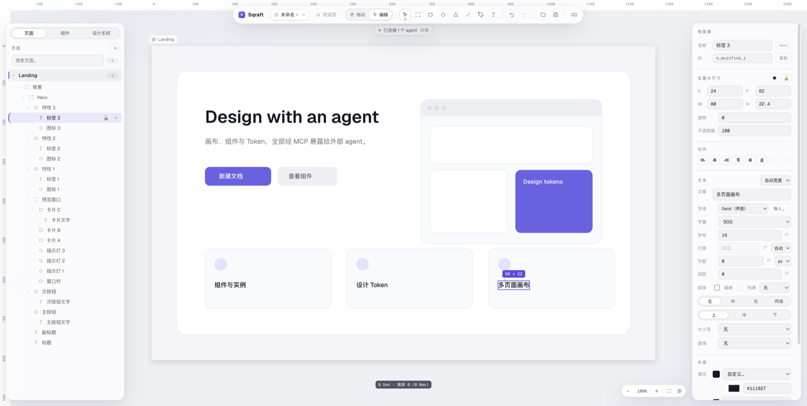

[English](README.md) · **中文** · [日本語](README.ja-JP.md) · [한국어](README.ko-KR.md)

# Sqraft

> AI 驱动的轻量 UI 设计工具 —— 桌面应用、本地文件、不联网也能画。

用画板、组件、自动布局和设计 Token 做界面；同时把这些能力通过 **MCP** 暴露给 Claude Code、Cursor 等 agent，让"用自然语言改稿"成为一等入口。

应用是纯单机的：没有账号、没有云、不调用任何模型。设计稿就是磁盘上的一个 `.sqraft` 文件。



## 下载

### [⬇ 下载最新版](https://github.com/wfdx165/sqraft/releases/latest)

- **macOS · Apple Silicon（M 系列）** · 约 120 MB
- **Windows · x64** · 约 100 MB · 未签名
- 在 Releases 页面的 **Assets** 里选 `Sqraft-<版本>-arm64.dmg`（手动安装）或 `Sqraft-Setup-<版本>.exe`；`.zip` 是 macOS 自动更新下载的包
- Windows 需要 Windows 10 22H2 或 Windows 11（x64）；Linux 暂不支持
- 历史版本与更新说明见 [Releases](https://github.com/wfdx165/sqraft/releases)

## 安装

### macOS

1. 打开下载的 `.dmg`，把 **Sqraft** 拖进「应用程序」
2. 应用已签名但尚未公证，首次打开 Gatekeeper 会拦一次：到 **系统设置 → 隐私与安全性**，在 Sqraft 旁边点 **仍要打开**
3. 之后启动时会自动检查更新：有新版本会后台下载，工具栏出现「重启更新」，退出或点它即可完成升级

不想自动更新也没关系：菜单 **帮助 → 检查更新…** 可以随时手动查。

### Windows

1. 双击 `Sqraft-Setup-<版本>.exe`；安装器未签名，SmartScreen 会拦一下，点 **更多信息 → 仍要运行**
2. 向导里可以改安装目录；默认按当前用户安装，不需要管理员权限。开始菜单与桌面都会创建快捷方式，不想要桌面那个直接删掉即可
3. 双击任意 `.sqraft` 文件即可用 Sqraft 打开
4. 更新是手动的：有新版本时应用会显示「前往下载」胶囊，点开 Releases 页面重新安装；卸载后数据仍保留在 `%APPDATA%\Sqraft`

## 能做什么

- **矢量画布**：矩形、椭圆、多边形、直线、钢笔路径、文本；无限画布 + 多页面
- **自动布局**：方向、间距、四边内边距、hug / fill / fixed、换行、拖拽重排
- **组件系统**：主组件、实例、插槽、实例覆盖与替换
- **原型链接**：点图层跳到另一个页面或返回上一屏，支持瞬间 / 淡入转场；演示模式可滚动页面，按 `H` 高亮热区
- **设计 Token**：颜色与数值（字号、圆角、间距……），改一处全局生效
- **改稿操作**：多选、框选、对齐分布、层级拖拽、分组、参考线、吸附
- **效果**：投影、内阴影、图层模糊、背景模糊
- **图片**：拖入、粘贴、裁切、蒙版、链接图（本地缓存）
- **AI 改稿**：agent 通过 MCP 直接建节点、改样式、截图自检，还能连原型链接——生成的设计稿可以点着走；一次工具调用 = 一步撤销
- **导出**：PNG（支持倍率）
- **界面语言**：中文 / English / 日本語 / 한국어，可自动跟随系统语言

## 接入 AI

Sqraft 自身不调用模型，也不需要 API Key。应用运行时会在本机开一个 MCP 端点，把你已有的 agent 接上来：

```
http://127.0.0.1:7331/mcp
```

应用需要保持运行（没有命令行工具，也不会由客户端拉起）。端口被占用时会自动顺延，实际地址在欢迎页和 **Sqraft → 配置 MCP…**（Windows 在文件菜单）里。

<details>
<summary>Claude Code</summary>

```bash
claude mcp add --transport http sqraft http://127.0.0.1:7331/mcp
```

</details>

<details>
<summary>OpenCode</summary>

```jsonc
{
  "$schema": "https://opencode.ai/config.json",
  "mcp": {
    "servers": {
      "sqraft": { "type": "remote", "url": "http://127.0.0.1:7331/mcp" }
    }
  }
}
```

</details>

<details>
<summary>Cursor / 其它 mcpServers 客户端</summary>

```jsonc
{
  "mcpServers": {
    "sqraft": { "url": "http://127.0.0.1:7331/mcp" }
  }
}
```

</details>

端点只监听 `127.0.0.1`、拒绝带 `Origin` 的请求，但**没有 token**：同一台机器上的其它进程也能连接。多客户端请求会串行执行。

## 本地优先

- 设计稿是磁盘上的 `.sqraft` 文件（zip 容器：快照 + 图片资源），不依赖云服务
- 没有账号、没有后端、没有遥测；外部请求只有两类：检查更新，以及你自己添加的链接图
- 操作日志写在系统日志目录（macOS：`~/Library/Logs/Sqraft/`），菜单 **帮助 → 打开日志目录** 可直达
- 卸载即删除应用；数据目录与偏好留在 `~/Library/Application Support/Sqraft/`（macOS）或 `%APPDATA%\Sqraft`（Windows），可一并删除

## 从源码构建

需要 macOS（Apple Silicon）或 Windows（x64）、Node.js 22.12（见 `.nvmrc`）与 pnpm 10.33.4。

```bash
pnpm install
pnpm dev      # 开发模式，渲染层 HMR
pnpm test     # 各包的 vitest
pnpm build    # 类型检查 + 生产构建
pnpm dist     # 按宿主平台出包：macOS 出 arm64 dmg 与 zip，Windows 出 x64 安装器
```

项目结构与评审流程见 [CONTRIBUTING.md](CONTRIBUTING.md)。

## 系统要求与已知限制

- **macOS Apple Silicon（M 系列）**；Intel Mac 不支持
- **Windows 10 22H2 及以上或 Windows 11（x64）**；Windows ARM64 与 Linux 不支持
- macOS 包**已签名但未公证**：首次打开需手动放行一次（见「安装」）；Windows 安装器**未签名**，首次运行会弹 SmartScreen
- 自动更新只在 macOS 上提供；Windows 需要自己下载新版安装器覆盖安装
- 中日韩文字使用各系统自带字体，同一文档在 macOS 与 Windows 上换行位置可能不同
- 没有多人协作、没有账户体系、没有云端同步

## 授权与反馈

Sqraft 以 [Apache License 2.0](LICENSE) 开源；「Sqraft」名称与应用图标不在授权范围内，fork 请改名换标。

欢迎提交 PR，规则见 [CONTRIBUTING.md](CONTRIBUTING.md)。遇到问题或想要新功能，在 [Issues](https://github.com/wfdx165/sqraft/issues) 里反馈。

---

Sqraft = **Square**（方形）+ **Craft**（工艺）。
